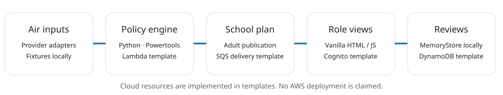

# AWS usage and deployment evidence

The narrowed live demonstration is complete: authenticated administrator dashboard showing persisted real regional air data and a real SQS-triggered in-app delivery receipt. See [completed demo evidence](deployment/DEMO_COMPLETE.md). No SMS/WhatsApp delivery or public hosting is claimed.

The AWS backend is deployed as `air-guardian-pilot` in ap-south-1 (account 137181255781), with verified live ARM64 Lambda execution, DynamoDB persistence and real CAMS ingestion. See [current evidence and gaps](deployment/STATUS.md). Public website hosting is blocked by AWS CloudFront account verification. The portal at http://localhost:5191/cloud.html connects to the deployed API and Cognito; it is locally served, not publicly hosted. The separate MemoryStore preview still contains fictional readings/adults. Real administrator login/dashboard access is verified; the full teacher/parent workflow remains unverified.

AWS open source is used by `cloud/local_engine.py`: the actual Powertools `APIGatewayRestResolver` dispatches `/engine`, and `Logger` decorates the Lambda handler without logging request bodies. The planning functions are the same pure Python rules used by the workspace. The local preview exposes this slice at `/local-engine`; inspect the response to demonstrate the tool rather than just displaying an AWS logo. Existing `backend/functions/community_api.py` also uses Powertools.

`template.yaml` implements API Gateway, Lambda, Cognito, DynamoDB, SQS, SSM, static hosting and optional sensor/notification resources. `cloud/store.py` uses boto3 DynamoDB transactions; ingestion uses a durable outbox and SQS relay. Live operator smoke tests verified ingestion, persisted history, relay and safe no-recipient queue processing. Contact delivery has consent, per-channel daily caps, quiet hours and opt-in configuration, but external message receipt is not verified. SMS/WhatsApp and sensors remain disabled. OpenSearch is not used by this cloud portal.

## Credential-free SAM slice

```powershell
python scripts/package_cloud.py
python -m pip install --target .build/backend -r cloud/requirements.txt
sam build --template-file template-local.yaml
sam local start-api --port 5190
# Open http://127.0.0.1:5190/engine
```

Docker and SAM CLI are available. The cloud package passed SAM's Linux ARM64 container build and Lambda-runtime native import checks before successful `sam deploy`. Authenticated AWS credentials were used without logging secrets. Follow [the pilot runbook](deployment/RUNBOOK.md) for the remaining hosting, authentication, alert confirmation and workflow verification steps. Scheduled resources being enabled is not proof of observed automatic execution.


